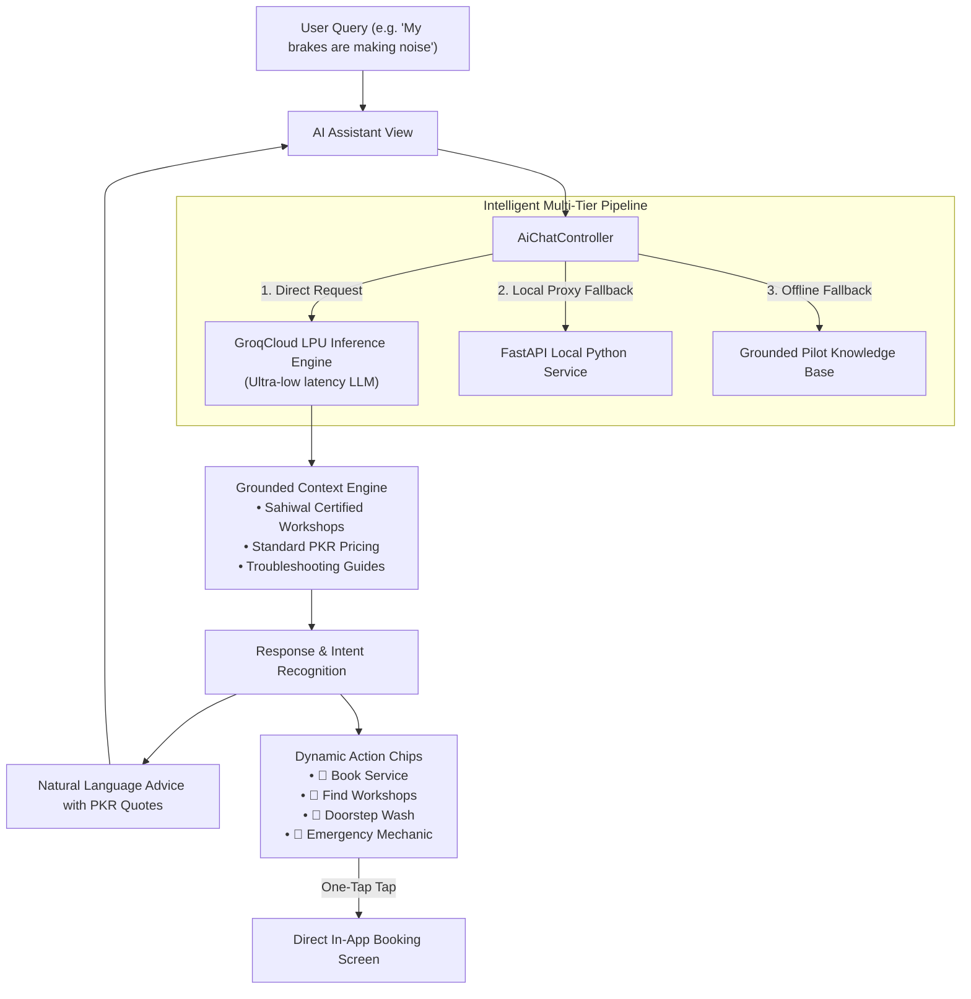

# 🚗 CARFIXZI — Verified Automotive Services & Workshop Marketplace

[](https://flutter.dev)
[](https://dart.dev)
[](https://fastapi.tiangolo.com)
[](https://python.org)
[](https://console.groq.com)
[](LICENSE)

**CARFIXZI** is an intuitive, multi-role automotive service marketplace designed to make vehicle maintenance, roadside assistance, and workshop management simple, transparent, and reliable. 

Initial pilot rollout: **Sahiwal District, Punjab, Pakistan**.

---

## 📑 Table of Contents
1. [User-Centric Design Principles (UI/UX)](#-user-centric-design-principles-uiux)
2. [How AI Works in CARFIXZI](#-how-ai-works-in-carfixzi)
3. [User Roles & Experience](#-user-roles--experience)
4. [Key Features & User Journey](#-key-features--user-journey)
5. [System Architecture](#-system-architecture)
6. [Folder Structure](#-folder-structure)
7. [Quick Start Guide](#-quick-start-guide)
8. [Testing & Quality Assurance](#-testing--quality-assurance)

---

## 🎨 User-Centric Design Principles (UI/UX)

CARFIXZI is crafted following human-centered UI/UX standards to ensure ease of use for customers, mechanics, and administrators alike:

- **Intuitive Plain-Language Terminology**:
  - Replaced technical jargon with familiar everyday words:
    - *"Log In"* instead of *"Ignite Session"*
    - *"Admin Panel"* instead of *"Root Console"*
    - *"My Vehicles"* instead of *"My Garage"*
    - *"Add Part"* instead of *"Add SKU"*
    - *"Save Photo"* instead of *"RenderRepaintBoundary Capture"*
- **Touch-Friendly & Accessible**:
  - Minimum touch target size of 48×48 dp for buttons and navigation items.
  - Generous spacing, readable typography, and accessible color contrast ratios (WCAG AA compliant).
- **Persistent Bottom Navigation**:
  - Both Customer and Workshop interfaces feature persistent, bottom navigation bars utilizing `IndexedStack` to preserve user scroll position and form inputs across tabs.
- **Adaptive Responsive Layouts**:
  - Uses `LayoutBuilder` and flexible cards that gracefully adapt between Android smartphones, tablets, and desktop/web browser widths without visual clipping or overflow.
- **Instant Photo Receipts**:
  - Branded receipts featuring the CARFIXZI logo, itemized bill, and official verification seal can be saved directly to the user's phone gallery with a single tap of the **"Save Photo"** button.

---

## 🤖 How AI Works in CARFIXZI

The **CARFIXZI Intelligent Assistant** provides instant, human-like automotive support, vehicle diagnostics, price estimates, and direct service booking right inside the chat.



### 1. Ultra-Fast GroqCloud Engine
The assistant is powered by ultra-fast inference on **GroqCloud LPUs (Language Processing Units)**, delivering response times under 1 second. This ensures customers and mechanics get real-time answers without lag.

### 2. Grounded Local Automotive Knowledge Base
Unlike generic chatbots that hallucinate information, CARFIXZI's AI is grounded in real, verified pilot data for Sahiwal, Pakistan:
- **Verified Workshop Directory**: Recommends certified workshops such as *Apex GT Motorwerks*, *Royal Auto Detailing Hub*, and *PakWheels Express Bay*.
- **Standardized PKR Pricing**: Gives realistic pricing ranges (e.g., Brake pad replacement: Rs 2,400 – Rs 5,500; Doorstep car wash: from Rs 800; Battery jumpstart: Rs 1,200).
- **Practical Troubleshooting**: Diagnoses symptoms like brake squeal, engine overheating, battery drain, or steering vibration and directs the user to the correct fix.

### 3. In-Chat Direct Booking Flow
Users can book services directly from the conversation:
- **Automatic Intent Recognition**: When a user mentions a repair, car wash, or emergency, the AI automatically generates clickable **action chips** (e.g., `[📅 Confirm & Book Service]`, `[🧼 Book Doorstep Wash]`, `[🚨 Call Emergency Mechanic]`).
- **Quick-Action Shortcut Bar**: A horizontal ribbon at the top of the chat allows one-tap access to instant service booking, roadside assistance, mobile car wash, and spare parts without having to type.

### 4. Robust 3-Tier Fallback Strategy
To guarantee uninterrupted service in all conditions:
1. **Direct Cloud Inference**: Queries GroqCloud directly for immediate responses.
2. **Backend Proxy Gateway**: Routes via the secure local FastAPI Python service if cloud endpoints require token validation.
3. **Offline Knowledge Base**: Provides verified answers and booking shortcuts even when completely offline or during network disruptions.

---

## 👥 User Roles & Experience

| Role | Interface Type | Everyday Name | Purpose & Features |
| :--- | :--- | :--- | :--- |
| **Customer / Car Owner** | Mobile App (Android) | **Customer Portal** | Discover workshops on map, book maintenance, order doorstep car wash, call roadside emergency mechanic, buy genuine parts, and track repair milestones. |
| **Workshop Partner** | Mobile App (Android) | **Partner Hub** | Manage active service bays, assign technicians, track parts inventory with low-stock alerts, accept customer bookings, and view monthly earnings. |
| **Regional Admin** | Web / Desktop | **Regional Console** | Verify workshop licenses, inspect CNIC and Tax documentation, and customize workshop registration forms. |
| **Super Admin** | Web / Desktop | **Admin Panel** | Configure platform commission policies, record verified settlements, oversee administrative staff, and monitor platform metrics. |

---

## 🚀 Key Features & User Journey

### 1. Customer Experience
- **Interactive OpenStreetMap Locator**: Browse certified workshops in Sahiwal with custom pins, reviews, operating hours, and bay availability.
- **Service Milestone Tracking**: Real-time progress bar from vehicle drop-off, diagnostic scan, parts replacement, to final inspection and handover.
- **Transparent Cash-on-Service**: Pay in Pakistani Rupees directly after inspecting the vehicle.
- **Digital Photo Receipts**: Tap to download and save an official, branded receipt with the CARFIXZI logo directly to the phone's gallery.

### 2. Workshop Partner Operations
- **5-Tab Navigation**: Clean bottom navigation between **Dashboard**, **Bookings**, **Inventory**, **Billing**, and **Profile**.
- **Live Bay Monitoring**: Track Bay 01 to Bay 04 with assigned mechanics, vehicle registration numbers, and live progress indicators.
- **Inventory Management**: Search spare parts, adjust stock with `+` and `−` steppers, and add new parts with one tap.
- **Clickable Settlement Receipts**: Tap any monthly settlement to inspect the 90/10 commission breakdown and save a branded photo receipt.

### 3. Super Admin Governance
- **One-Tap Card Navigation**: Every card in the Admin Panel is fully clickable to jump straight into governance tools.
- **Flexible Commission Setting**: Adjust service, parts, wash, and mobile mechanic commission either **by entering an exact digit** (e.g., `10.0%`) or **by sliding the range bar**.
- **Audited Settlements**: Record physical partner payouts and cash commissions with full audit trails.

---

## 🏛️ System Architecture

CARFIXZI follows **Clean MVVM Architecture** combined with **GetX** for dependency injection and state management:

```
┌────────────────────────────────────────────────────────────────────────┐
│                        PRESENTATION LAYER                              │
│   GetX Controllers  ◄──────────────────►  Responsive UI & Design System│
│   • AuthController                        • Customer Views             │
│   • AiChatController                      • Workshop Partner Hub       │
│   • CartController                        • Regional Admin Console     │
│   • FormBuilderController                 • Super Admin Panel          │
└────────────────────────────────────┬───────────────────────────────────┘
                                     │
┌────────────────────────────────────▼───────────────────────────────────┐
│                           DOMAIN LAYER                                 │
│   Entities, Enums & Use Cases (Pure Dart, Zero UI Dependency)          │
│   • ServiceItem, PartItem, FormFieldConfig, SettlementRecord           │
│   • UserRole, BookingStatus, OrderStatus, PaymentStatus                │
│   • CurrencyUtils (Strict Integer PKR Paisa: 1 PKR = 100 Paisa)        │
└────────────────────────────────────┬───────────────────────────────────┘
                                     │
┌────────────────────────────────────▼───────────────────────────────────┐
│                            DATA LAYER                                  │
│   Data Providers, Repositories & External Services                     │
│   • Firebase Authentication (Secure session management)                │
│   • OpenStreetMap / flutter_map (Free, open-source geospatial data)    │
│   • Cloudinary Media Service (High-speed document & image CDN)         │
│   • GroqCloud API (Ultra-low latency AI inference)                     │
│   • Python FastAPI Service (Secure enterprise proxy & form governance) │
└────────────────────────────────────────────────────────────────────────┘
```

---

## 📂 Folder Structure

```
carfixzi/
├── lib/
│   ├── app/
│   │   ├── bindings/             # Initial GetX dependency injection
│   │   ├── middleware/           # Role-based route guards
│   │   └── routes/               # AppRoutes & AppPages
│   ├── core/
│   │   ├── constants/            # AppConstants, ApiEndpoints, AppSecrets
│   │   ├── enums/                # UserRole, BookingStatus, PaymentStatus
│   │   ├── security/             # Biometric authentication
│   │   └── utils/                # CurrencyUtils, Validators
│   ├── features/
│   │   ├── admin/                # Regional Admin views & form builder
│   │   ├── ai_assistant/         # Groq AI chat controller & view
│   │   ├── auth/                 # Splash, login, registration, email verify
│   │   ├── customer/             # Home, map locator, bookings, parts cart
│   │   ├── partner/              # Workshop dashboard, inventory, billing
│   │   └── super_admin/          # Commission policies, settlements, staff
│   ├── shared/widgets/           # Branded buttons, cards, receipt dialog
│   └── theme/                    # AppColors, AppTypography, AppTheme
├── backend/                      # Python FastAPI trusted service
│   ├── app/
│   │   ├── api/                  # AI proxy, form builder, settlements
│   │   ├── models/               # Pydantic schemas
│   │   └── main.py               # FastAPI entry point
│   └── requirements.txt
├── assets/
│   ├── images/                   # App logo and graphics
│   └── icons/                    # Vector icons
└── pubspec.yaml
```

---

## 🛠️ Quick Start Guide

### 1. Prerequisites
- **Flutter SDK**: `>= 3.13.4`
- **Dart SDK**: `>= 3.13.4`
- **Python**: `>= 3.10`

### 2. Setting Up the Mobile / Web Client
```bash
# 1. Fetch Flutter packages
flutter pub get

# 2. Run on Android device or emulator
flutter run -d android

# 3. Run on Chrome for Admin web consoles
flutter run -d chrome
```

### 3. Setting Up the FastAPI Backend (Optional Proxy)
```bash
cd backend

# Create virtual environment
python -m venv venv
.\venv\Scripts\Activate.ps1       # Windows
source venv/bin/activate          # macOS/Linux

# Install dependencies and start server
pip install -r requirements.txt
python -m uvicorn app.main:app --host 0.0.0.0 --port 8000 --reload
```

---

## 🧪 Testing & Quality Assurance

Run the comprehensive test suite to verify business logic and calculations:
```bash
# Run unit & widget tests
flutter test

# Run code analysis
flutter analyze
```

---

