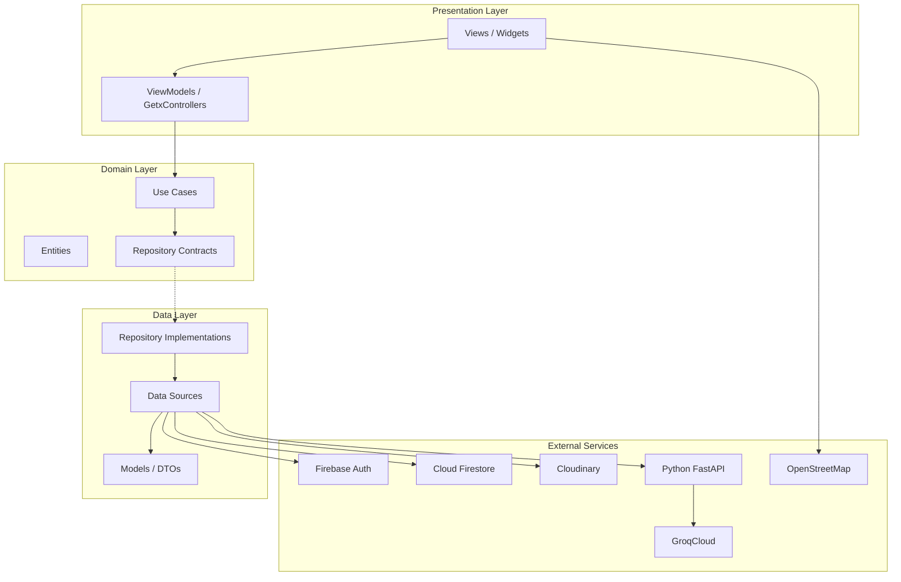
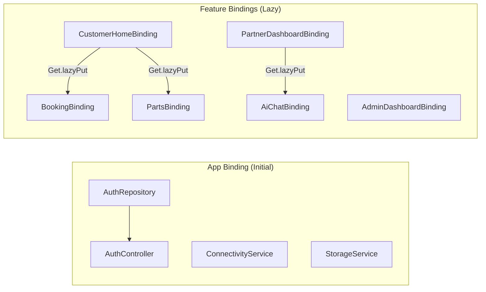
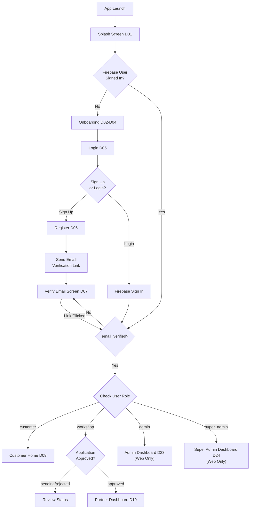
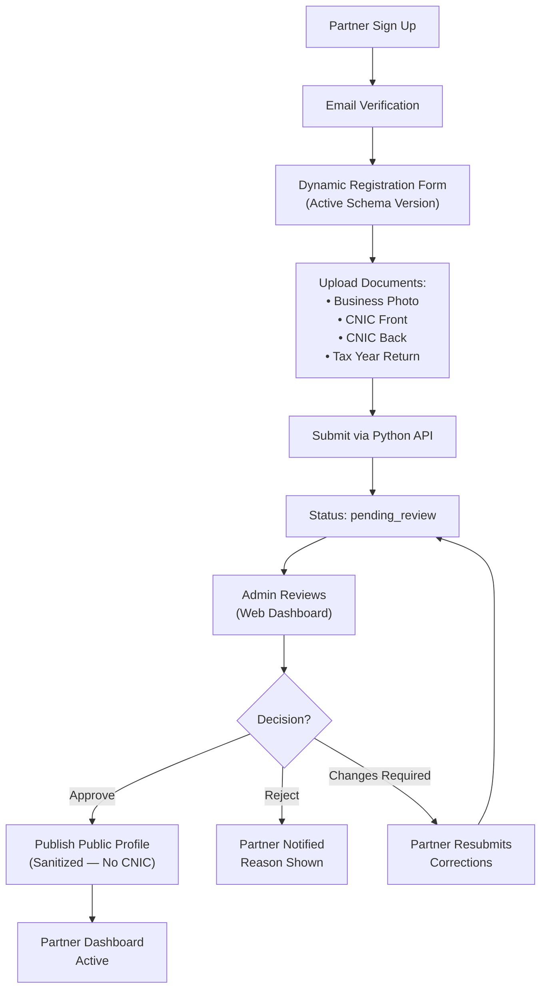
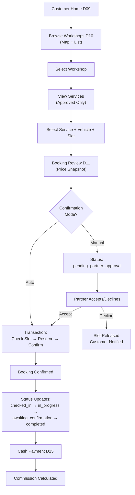
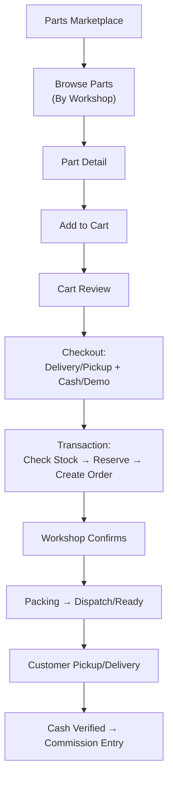
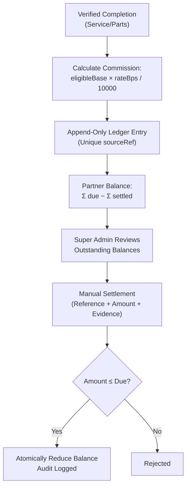
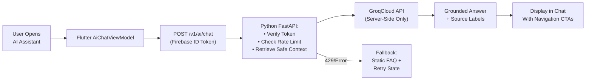
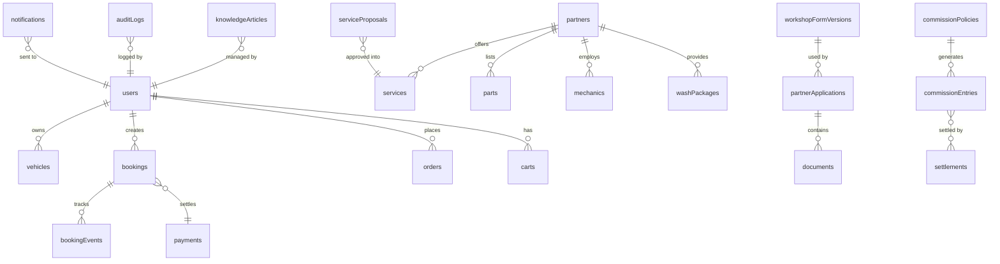

# 🚗 CARFIXZI — Architecture, Flow & Design Analysis

> **FYP SaaS Automotive Marketplace** | Flutter MVVM + GetX + Firebase + Python FastAPI

---

## 1. Project Overview

CARFIXZI is a **verified automotive services marketplace** for a single-city pilot in Pakistan. It connects vehicle owners with approved workshops, mobile mechanics, car/bike wash providers, and spare parts — all under administrative oversight with commission tracking.

| Surface | Stack |
|---------|-------|
| **Android Mobile** | Flutter — Customer & Partner experiences |
| **Admin Web** | Flutter Web — Admin & Super Admin dashboards |
| **Backend** | Python FastAPI (local demo) + Firebase Admin SDK |
| **Database** | Cloud Firestore (Spark plan) |
| **Auth** | Firebase Email/Password + Email Verification Link |
| **Media** | Cloudinary (public images + protected identity docs) |
| **Maps** | OpenStreetMap + `flutter_map` |
| **AI Chat** | GroqCloud via Python API proxy |
| **Payments** | Cash-on-service + Demo mode (no real gateway) |

---

## 2. Architecture: MVVM + GetX + Clean Architecture

### 2.1 Layered Architecture Diagram



### 2.2 GetX Dependency Injection Strategy



**Key DI Rules:**
- `Get.put()` for app-wide singletons (Auth, Connectivity, Storage)
- `Get.lazyPut()` for feature-scoped repositories and controllers
- `Get.find()` to retrieve injected dependencies
- Repository contracts (abstract classes) injected, not implementations
- Every ViewModel receives repositories via constructor injection
- **No** Provider, Bloc, or Riverpod

### 2.3 MVVM Contract Pattern

```dart
// Domain Layer - Contract
abstract class PartnerRepository {
  Future<List<PartnerSummary>> getApprovedPartners(String cityId);
  Future<PartnerDetail> getPartnerById(String partnerId);
}

// Data Layer - Implementation
class FirestorePartnerRepository implements PartnerRepository {
  final FirebaseFirestore _firestore;
  FirestorePartnerRepository(this._firestore);
  // ... query logic with DTO mapping
}

// Presentation Layer - ViewModel
class PartnerListViewModel extends GetxController {
  final PartnerRepository _repo;
  PartnerListViewModel(this._repo);

  final isLoading = false.obs;
  final partners = <PartnerSummary>[].obs;
  final errorMessage = RxnString();

  Future<void> loadApprovedPartners(String cityId) async {
    isLoading.value = true;
    try {
      partners.value = await _repo.getApprovedPartners(cityId);
    } catch (e) {
      errorMessage.value = e.toString();
    } finally {
      isLoading.value = false;
    }
  }
}
```

---

## 3. Monorepo Project Structure

```
d:\fyp\carfixzi\
├── lib/
│   ├── main.dart                          # App entry point
│   ├── app/
│   │   ├── app.dart                       # GetMaterialApp configuration
│   │   ├── bindings/
│   │   │   ├── initial_binding.dart        # App-wide DI
│   │   │   ├── customer_binding.dart
│   │   │   ├── partner_binding.dart
│   │   │   ├── admin_binding.dart
│   │   │   └── super_admin_binding.dart
│   │   ├── routes/
│   │   │   ├── app_routes.dart            # Route constants
│   │   │   └── app_pages.dart             # GetPage definitions
│   │   ├── middleware/
│   │   │   ├── auth_middleware.dart        # Firebase auth + email_verified gate
│   │   │   ├── role_middleware.dart        # Role-based route guard
│   │   │   └── email_verified_middleware.dart
│   │   └── config/
│   │       ├── app_config.dart            # Environment config
│   │       ├── firebase_config.dart
│   │       └── api_config.dart            # Python API base URL
│   │
│   ├── core/
│   │   ├── constants/
│   │   │   ├── app_constants.dart
│   │   │   ├── firestore_paths.dart       # Collection path constants
│   │   │   ├── api_endpoints.dart
│   │   │   └── asset_paths.dart
│   │   ├── enums/
│   │   │   ├── user_role.dart             # super_admin, admin, workshop, customer
│   │   │   ├── partner_type.dart          # workshop, mobile_wash, both
│   │   │   ├── booking_status.dart        # Full state machine enum
│   │   │   ├── order_status.dart
│   │   │   ├── payment_status.dart
│   │   │   ├── application_status.dart
│   │   │   ├── commission_status.dart
│   │   │   └── proposal_status.dart
│   │   ├── errors/
│   │   │   ├── app_exception.dart
│   │   │   ├── auth_exception.dart
│   │   │   └── api_exception.dart
│   │   ├── utils/
│   │   │   ├── validators.dart            # Email, phone +92, password strength
│   │   │   ├── currency_utils.dart        # PKR paisa formatting
│   │   │   ├── date_utils.dart
│   │   │   ├── distance_utils.dart        # Haversine calculation
│   │   │   └── logger.dart
│   │   ├── network/
│   │   │   ├── api_client.dart            # HTTP client with Firebase token
│   │   │   ├── api_response.dart
│   │   │   └── connectivity_service.dart
│   │   └── security/
│   │       ├── biometric_service.dart     # local_auth wrapper
│   │       └── secure_storage_service.dart
│   │
│   ├── theme/
│   │   ├── app_theme.dart                 # CARFIXZI theme data
│   │   ├── app_colors.dart                # #003974, #1F5EAC, #FAF8FF, gold
│   │   ├── app_typography.dart            # Space Grotesk + Hanken Grotesk
│   │   ├── app_spacing.dart
│   │   └── app_decorations.dart           # Elevation, borders, shapes
│   │
│   ├── shared/
│   │   ├── widgets/
│   │   │   ├── carfixzi_app_bar.dart
│   │   │   ├── carfixzi_button.dart       # Primary (gold), Secondary (navy), Ghost
│   │   │   ├── carfixzi_text_field.dart
│   │   │   ├── carfixzi_card.dart
│   │   │   ├── loading_widget.dart
│   │   │   ├── error_widget.dart
│   │   │   ├── empty_state_widget.dart
│   │   │   ├── offline_banner.dart
│   │   │   ├── confirmation_dialog.dart
│   │   │   ├── status_badge.dart
│   │   │   ├── rating_widget.dart
│   │   │   └── image_picker_widget.dart
│   │   ├── models/
│   │   │   ├── user_model.dart
│   │   │   ├── partner_model.dart
│   │   │   ├── service_model.dart
│   │   │   ├── booking_model.dart
│   │   │   ├── vehicle_model.dart
│   │   │   ├── order_model.dart
│   │   │   ├── part_model.dart
│   │   │   ├── payment_model.dart
│   │   │   ├── commission_model.dart
│   │   │   ├── notification_model.dart
│   │   │   └── form_field_config_model.dart
│   │   └── services/
│   │       ├── notification_service.dart
│   │       └── location_service.dart
│   │
│   ├── features/
│   │   ├── auth/
│   │   │   ├── data/
│   │   │   │   ├── datasources/
│   │   │   │   │   └── firebase_auth_datasource.dart
│   │   │   │   ├── models/
│   │   │   │   │   └── auth_user_dto.dart
│   │   │   │   └── repositories/
│   │   │   │       └── auth_repository_impl.dart
│   │   │   ├── domain/
│   │   │   │   ├── entities/
│   │   │   │   │   └── auth_user.dart
│   │   │   │   ├── contracts/
│   │   │   │   │   └── auth_repository.dart
│   │   │   │   └── usecases/
│   │   │   │       ├── sign_up_usecase.dart
│   │   │   │       ├── sign_in_usecase.dart
│   │   │   │       ├── verify_email_usecase.dart
│   │   │   │       └── reset_password_usecase.dart
│   │   │   └── presentation/
│   │   │       ├── views/
│   │   │       │   ├── splash_view.dart          # D01
│   │   │       │   ├── onboarding_view.dart       # D02-D04
│   │   │       │   ├── login_view.dart            # D05
│   │   │       │   ├── register_view.dart         # D06
│   │   │       │   ├── verify_email_view.dart     # D07 (repurposed)
│   │   │       │   └── forgot_password_view.dart
│   │   │       ├── viewmodels/
│   │   │       │   ├── auth_viewmodel.dart
│   │   │       │   ├── splash_viewmodel.dart
│   │   │       │   └── onboarding_viewmodel.dart
│   │   │       └── widgets/
│   │   │           ├── password_strength_indicator.dart
│   │   │           └── social_login_section.dart
│   │   │
│   │   ├── customer/
│   │   │   ├── data/ domain/ presentation/
│   │   │   │   ├── home/                # D09 — Customer dashboard
│   │   │   │   ├── discovery/           # D10 — Workshop locator map
│   │   │   │   ├── booking/             # D11 — Service booking
│   │   │   │   ├── service_detail/      # D12 — Repair details
│   │   │   │   ├── wash/                # D13 — Car wash booking
│   │   │   │   ├── tracking/            # D14 — Service tracking
│   │   │   │   ├── checkout/            # D15 — Payment checkout
│   │   │   │   ├── history/             # D16 — Service history
│   │   │   │   ├── profile/             # D17 — Profile & garage
│   │   │   │   ├── vehicles/            # D08 — Vehicle registration
│   │   │   │   ├── parts/               # NEW — Spare parts marketplace
│   │   │   │   ├── mechanic/            # NEW — Mobile mechanic request
│   │   │   │   ├── orders/              # NEW — Parts orders
│   │   │   │   ├── notifications/       # NEW — Notification center
│   │   │   │   └── ai_assistant/        # NEW — GroqCloud AI chat
│   │   │
│   │   ├── partner/
│   │   │   ├── data/ domain/ presentation/
│   │   │   │   ├── onboarding/          # D18 — Workshop registration
│   │   │   │   ├── dashboard/           # D19/D20 — Partner dashboard
│   │   │   │   ├── inventory/           # D21 — Inventory management
│   │   │   │   ├── billing/             # D22 — Billing & invoices
│   │   │   │   ├── services/            # Service management
│   │   │   │   ├── bookings/            # Booking queue management
│   │   │   │   ├── staff/               # Mechanic roster
│   │   │   │   ├── wash_packages/       # Wash package management
│   │   │   │   ├── finance/             # Commission & settlement
│   │   │   │   └── ai_assistant/        # NEW — GroqCloud AI chat
│   │   │
│   │   ├── admin/
│   │   │   ├── data/ domain/ presentation/
│   │   │   │   ├── dashboard/           # D23 — Admin dashboard
│   │   │   │   ├── verifications/       # Onboarding review queue
│   │   │   │   ├── proposals/           # Service/price approval queue
│   │   │   │   ├── disputes/            # Case management
│   │   │   │   ├── form_builder/        # NEW — Workshop form builder
│   │   │   │   ├── audit/               # Audit log viewer
│   │   │   │   └── ai_assistant/        # NEW — AI support
│   │   │
│   │   └── super_admin/
│   │       ├── data/ domain/ presentation/
│   │       │   ├── dashboard/           # D24 — Super Admin dashboard
│   │       │   ├── admins/              # Admin account management
│   │       │   ├── partners/            # Partner oversight
│   │       │   ├── customers/           # Customer management
│   │       │   ├── commission/          # Commission policies
│   │       │   ├── settlements/         # Settlement ledger
│   │       │   ├── form_governance/     # NEW — Field retire/restore
│   │       │   ├── settings/            # System settings
│   │       │   └── ai_assistant/        # NEW — AI support
│   │
│   └── firebase/
│       └── firebase_options.dart
│
├── test/                                  # Unit & widget tests
├── integration_test/                      # Integration tests
├── assets/
│   ├── images/
│   ├── icons/
│   └── fonts/
│       ├── SpaceGrotesk/
│       └── HankenGrotesk/
├── android/
├── web/
├── pubspec.yaml
└── analysis_options.yaml
```

---

## 4. Application Flow Diagrams

### 4.1 Authentication & Role Routing Flow



### 4.2 Partner Onboarding & Verification Flow



### 4.3 Customer Booking Flow



### 4.4 Spare Parts Order Flow



### 4.5 Commission & Settlement Flow



### 4.6 AI Chat Flow (GroqCloud)



---

## 5. Four Roles — Permission Matrix

| Capability | Customer | Partner | Admin | Super Admin |
|------------|----------|---------|-------|-------------|
| Self-register | ✅ | ✅ (pending) | ❌ | ❌ (bootstrap) |
| Browse workshops | ✅ | ✅ | ✅ | ✅ |
| Book services | Own | ❌ | View | All |
| Buy parts | Own | ❌ | View | All |
| Submit verification | ❌ | Own | View All | All |
| View CNIC/tax docs | ❌ | Own | Approval | All |
| Publish workshop | ❌ | ❌ | Approve | Override |
| Approve services | ❌ | ❌ | ✅ | Override |
| Manage bookings | ❌ | Own | Review | All |
| Configure commission | ❌ | ❌ | Read | ✅ |
| Create admins | ❌ | ❌ | ❌ | ✅ |
| Form Builder — edit | ❌ | ❌ | ✅ | ✅ |
| Form Builder — retire | ❌ | ❌ | ❌ | ✅ only |
| AI Chat | ✅ | ✅ | ✅ | ✅ |

---

## 6. Firestore Collections Map



---

## 7. State Machines

### Booking Status Chain
```
requested → pending_partner_approval (manual) | confirmed (auto)
    → checked_in → in_progress → awaiting_confirmation → completed
    ↗ cancel / dispute branches at applicable states
```

### Partner Application Status
```
draft → pending_review → approved | rejected | changes_required
    → pending_review (resubmit)
    approved → suspended (Super Admin only)
```

### Part Order Status
```
placed → confirmed → packing → out_for_delivery | ready_for_pickup → fulfilled
    ↗ rejected / cancelled / returned branches
```

---

## 8. Design System (from DESIGN.md)

| Token | Value |
|-------|-------|
| **Primary Blue** | `#003974` / `#00509D` |
| **Secondary Navy** | `#003F88` |
| **Accent Gold** | `#FFE45E` / `#C3AB28` |
| **Background** | `#FAF8FF` |
| **On Surface** | `#171B2B` |
| **Dark Slate** | `#2D3142` |
| **Headline Font** | Space Grotesk (600-700) |
| **Body Font** | Hanken Grotesk (400) |
| **Border Radius** | 8px standard, 16px modals, full pill for badges |
| **Primary CTA** | Gold `#FFE45E` fill + Dark Slate text |
| **Secondary CTA** | Navy `#003F88` fill + White text |
| **Ghost CTA** | White bg + Blue `#00509D` border |

---

## 9. Screen Inventory (27 Mockups + NEW Screens)

### Existing Screens — Disposition

| ID | Screen | Target | Action |
|----|--------|--------|--------|
| D01 | Splash Screen | Shared | REUSE — real auth routing |
| D02 | Onboarding (Instant Booking) | Customer | REUSE — remove guarantees |
| D03 | Onboarding (Live Tracking) | Customer | REWRITE — booking status only |
| D04 | Onboarding (Get Started) | Customer | REUSE — connect to auth |
| D05 | Login | Shared | REWRITE — email/password |
| D06 | Registration | Customer | REWRITE — strong password |
| D07 | OTP Verification | Shared | REPURPOSE → Email Verification |
| D08 | Vehicle Registration | Customer | REWRITE — car/bike fields |
| D09 | Customer Home Dashboard | Customer | REUSE — all entry points |
| D10 | Workshop Locator | Customer | REWRITE — OSM map + filters |
| D11 | Service Booking | Customer | REWRITE — PKR, slot checks |
| D12 | Service Repair Details | Customer | REWRITE — real job status |
| D13 | Car Wash Booking | Customer | REWRITE — car/bike packages |
| D14 | Live Service Tracking | Customer | REWRITE — milestone status |
| D15 | Payment Checkout | Customer | REWRITE — cash/demo only |
| D16 | Service History | Customer | REUSE — real data |
| D17 | Customer Profile/Garage | Customer | REWRITE — no telemetry |
| D18 | Workshop Registration | Partner | REWRITE — dynamic form |
| D19 | Shop Owner Dashboard | Partner | REUSE — queue + earnings |
| D20 | Workshop Executive Overview | Partner | MERGE with D19 |
| D21 | Inventory Management | Partner | REWRITE — stock + pricing |
| D22 | Billing/Invoice Portal | Partner | REWRITE — PKR + commission |
| D23 | Admin Dashboard | Admin Web | REWRITE — verification queue |
| D24 | Super Admin Dashboard | Super Web | REWRITE — global controls |
| D25 | Access Management | Admin Web | LIMIT — role/audit only |
| D26 | AI Diagnostic Assistant | Future | DEFER |
| D27 | Bay Live Camera | Future | DEFER |

### NEW Screens Required

| ID | Screen | Target |
|----|--------|--------|
| NEW-01 | Email Verification/Resend | Shared (Android + Web) |
| NEW-02 | Workshop Detail/Profile | Customer |
| NEW-03 | My Bookings List | Customer |
| NEW-04 | Mobile Mechanic Request | Customer |
| NEW-05 | Parts Marketplace | Customer |
| NEW-06 | Cart + Checkout | Customer |
| NEW-07 | My Orders | Customer |
| NEW-08 | AI Chat Assistant | Customer + Partner (Android) |
| NEW-09 | AI Chat Assistant | Admin + Super Admin (Web) |
| NEW-10 | Workshop Form Builder | Admin Web |
| NEW-11 | Field Retire/Restore | Super Admin Web |
| NEW-12 | Partner Dynamic Registration | Partner |
| NEW-13 | Commission Policy Manager | Super Admin Web |
| NEW-14 | Settlement Ledger | Super Admin Web |
| NEW-15 | Audit Log Viewer | Admin/Super Web |
| NEW-16 | FAQ/Knowledge Manager | Admin/Super Web |

---

## 10. Dependencies (pubspec.yaml Plan)

```yaml
dependencies:
  flutter:
    sdk: flutter
  
  # State Management & DI
  get: ^4.7.2                      # ONLY state/routing/DI
  
  # Firebase
  firebase_core: ^3.13.0
  firebase_auth: ^5.6.0
  cloud_firestore: ^5.6.7
  firebase_messaging: ^15.2.7
  
  # Secure Storage & Biometrics
  flutter_secure_storage: ^9.2.4
  local_auth: ^2.3.0               # Android only
  
  # Maps
  flutter_map: ^7.0.2
  latlong2: ^0.9.1
  geolocator: ^13.0.2
  
  # Media
  image_picker: ^1.1.2
  file_picker: ^8.1.7
  cached_network_image: ^3.4.1
  
  # HTTP
  http: ^1.4.0
  
  # UI
  google_fonts: ^6.2.1             # Space Grotesk + Hanken Grotesk
  flutter_svg: ^2.0.17
  shimmer: ^3.0.0
  intl: ^0.19.0

dev_dependencies:
  flutter_test:
    sdk: flutter
  flutter_lints: ^6.0.0
  mockito: ^5.4.5
  build_runner: ^2.4.14
```

---

## 11. Python FastAPI Backend Structure

```
backend/
├── app/
│   ├── main.py                    # FastAPI app + CORS + lifespan
│   ├── api/
│   │   ├── auth.py                # Token verification middleware
│   │   ├── partners.py            # Application decisions
│   │   ├── services.py            # Service proposal decisions
│   │   ├── bookings.py            # Booking creation + transitions
│   │   ├── orders.py              # Parts order + inventory
│   │   ├── media.py               # Cloudinary upload authorize
│   │   ├── payments.py            # Cash confirmation
│   │   ├── settlements.py         # Super Admin settlement
│   │   ├── admins.py              # Admin provisioning
│   │   ├── ai_chat.py             # /v1/ai/chat endpoint
│   │   ├── knowledge.py           # FAQ publish/retrieve
│   │   └── workshop_form.py       # Form schema CRUD
│   ├── models/                    # Pydantic request/response models
│   ├── services/
│   │   ├── firebase_service.py    # Admin SDK operations
│   │   ├── cloudinary_service.py
│   │   ├── groq_service.py        # GroqCloud chat completions
│   │   └── knowledge_service.py   # Safe retrieval
│   ├── security/
│   │   ├── token_verifier.py      # Firebase ID token + email_verified
│   │   └── role_checker.py        # Role authorization
│   └── settings.py                # Environment config
├── tests/
├── requirements.txt
├── .env.example                   # GROQ_API_KEY= placeholder
└── README.md
```

---

## 12. Implementation Phases (P0–P9)

| Phase | Work Package | Key Deliverables |
|-------|-------------|------------------|
| **P0** | Discovery & Design Audit | ✅ This document — screen matrix, architecture, route catalog |
| **P1** | Project Bootstrap | Monorepo, GetX DI/routing, theme, Firebase config, empty shells |
| **P2** | Authentication & 4 Roles | Email/password, verification link, role routing, biometric lock |
| **P3** | Partner Onboarding | Cloudinary media, dynamic form builder, admin review, publish |
| **P4** | Service Catalogue & Ops | Partner profile, availability, mechanic roster, proposals |
| **P5** | Customer Discovery & Bookings | OSM map, slots, auto/manual booking, wash, mechanic |
| **P6** | Parts Marketplace | Parts CRUD, cart, order transaction, stock management |
| **P7** | Commission & Settlement | Policy engine, ledger, settlement UI, disputes, audit |
| **P8** | GroqCloud AI Assistant | Chat UI, Python proxy, FAQ retrieval, 429 fallback |
| **P9** | Polish, Tests & Delivery | UX states, security tests, seed data, APK, README |

> [!IMPORTANT]
> Each phase has mandatory exit criteria: real persistence, passing tests, security denial tests, and a handoff note. No phase is marked complete without evidence.

---

## 13. Next Steps

This document completes **Phase P0 — Discovery & Design Audit**. The recommended next step is:

1. **P1 — Project Bootstrap**: Set up the monorepo structure, install all dependencies, configure GetX routing/bindings, implement the CARFIXZI theme system, and create empty shell screens for all 4 roles.

> [!TIP]
> Since this is a large FYP project, I recommend using the `/plan` command to create a detailed implementation plan for Phase P1, or `/goal` to let me work through it end-to-end.

Would you like me to proceed with **P1 — Project Bootstrap** and start building the actual Flutter project structure with GetX MVVM architecture?
